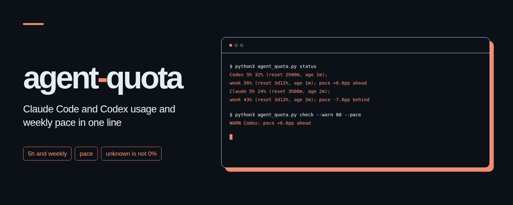

# agent-quota
<p align="center"></p>

Claude Code와 Codex CLI 구독 사용률과 주간 사용 속도를 터미널 한 줄로 보여 줍니다.

[English](README.md)

## 왜 만들었나요

사용률 숫자만 봐서는 한도가 초기화될 때까지 버틸지 가늠하기 어렵습니다. 이 도구는 5시간 및 주간 사용률, 초기화까지 남은 시간, 기록 나이, 그리고 주간 균등 몫보다 얼마나 빠르거나 느린지를 한줄에 함께 보여 줍니다. 파이썬 표준 라이브러리만 사용하며 외부로 네트워크 요청을 보내지 않습니다.

## 설치 3단계

1. 저장소를 내려받아 압축을 풀고 폴더를 엽니다. Python 3.10 이상이 필요합니다. Codex CLI와 Claude Code는 평소처럼 구독 계정으로 로그인해 둡니다.
2. 스크립트 파일 하나를 고정된 위치로 복사합니다.

   ```sh
   mkdir -p "$HOME/.local/share/agent-quota"
   cp agent_quota.py "$HOME/.local/share/agent-quota/agent_quota.py"
   ```

3. `~/.claude/settings.json`의 기존 설정을 유지하면서 아래 항목을 합칩니다.

   ```json
   {
     "statusLine": {
       "type": "command",
       "command": "python3 \"$HOME/.local/share/agent-quota/agent_quota.py\" statusline"
     }
   }
   ```

   Claude Code가 표준 입력으로 JSON을 보냅니다. 사용량 정보가 담긴 응답을 받으면 상태 줄을 출력하고 `~/.cache/agent-quota/claude.json`에 사용량을 저장합니다. `python3 ~/.local/share/agent-quota/agent_quota.py status`를 실행하면 두 엔진을 함께 볼 수 있습니다. Codex 사용량은 `~/.codex/sessions`에 있는 기존 기록만 읽으며, 값을 갱신하려고 새 세션을 실행하지는 않습니다.

**2026-11-02**에 확인한 [Claude Code 공식 상태 줄 문서](https://code.claude.com/docs/en/statusline#available-data)에는 `rate_limits.five_hour.used_percentage`, `rate_limits.seven_day.used_percentage`, 그리고 각 구간의 초기화 시각인 `resets_at`(유닉스 초 단위)이 나와 있습니다. 이 값들은 해당 구독의 첫 API 응답 이후에 나타나며, 각 구간은 따로 빠질 수 있습니다. `context_window.used_percentage`는 대화 공간 사용률이므로 구독 사용량 계산에는 쓰지 않습니다. 사용 중인 클라이언트나 계정에서 사용량 필드를 보내지 않으면 기존 캐시 파일만 읽습니다. 필요한 경우 아래 형식으로 캐시 파일을 직접 작성해 쓸 수 있습니다.

## 명령

저장소 폴더에서 실행하거나 설치한 스크립트 경로로 바꿔서 실행합니다.

| 명령 | 결과 |
| --- | --- |
| `python3 agent_quota.py status` | 두 엔진의 구간별 사용률, 남은 시간, 기록 나이, 주간 페이스를 한 줄로 표시 |
| `python3 agent_quota.py status --json` | 버전 정보가 포함된 JSON 출력. 알 수 없는 측정값은 `null` |
| `python3 agent_quota.py check --warn 80 --pace` | 어느 구간이든 80% 이상이거나 주간 몫보다 빨리 썼으면 경고 |
| `python3 agent_quota.py check --engine codex` | Codex만 확인. 엔진 하나만 설정했을 때 유용 |
| `python3 agent_quota.py statusline` | 표준 입력으로 Claude Code JSON을 받아 사용량을 저장하고 Claude 상태 줄 출력 |
| `python3 agent_quota.py status --codex-dir ./sessions --claude-cache ./data/claude.local.json` | 직접 지정한 로컬 기록과 캐시 파일 읽기 |
| `python3 agent_quota.py check --stale-hours 3` | 오래된 기록 기준을 기본 6시간에서 3시간으로 변경 |

옵션은 하위 명령 뒤에 붙입니다. `--claude-cache PATH`와 `--stale-hours HOURS`는 모든 명령에서 쓸 수 있습니다. `--engine all|codex|claude`와 `--codex-dir PATH`는 `status`와 `check`에서 씁니다. 캐시 위치를 바꿀 때는 상태 줄 설정과 조회 명령 양쪽에 같은 경로를 넣어야 합니다.

`check`는 항상 한 줄을 출력합니다. 종료 코드 **0**은 선택한 모든 구간이 최신 상태이고 켜 둔 경고 기준 아래에 있다는 뜻입니다. 종료 코드 **1**은 확인이 필요하다는 뜻으로, 기준치 초과, 주간 몫 초과, 오래된 기록, 알 수 없는 값, 초기화 시각 경과가 포함됩니다. 기록이 오래되었거나 값을 알 수 없을 때는 기준치나 페이스를 초과했다고 단정하지 않습니다. 종료 코드 **2**는 잘못된 명령 인자, 잘못된 상태 줄 입력, 캐시 파일 쓰기 실패입니다. `status`는 데이터가 없어도 종료 코드 0을 내므로 JSON을 가져다 쓰는 쪽에서 내부 필드를 확인해야 합니다. 자체 알림 발송 기능은 없으니 `check`를 cron이나 기존 알림 도구에 연결해 쓰면 됩니다.

## 출력 예

실제 계정이 아닌 임의로 만든 예시 값입니다.

```text
Codex 5h 32% (reset 2h00m, age 1m); week 56% (reset 3d12h, age 1m); pace +6.0pp ahead | Claude 5h 24% (reset 3h00m, age 2m); week 43% (reset 3d12h, age 2m); pace -7.0pp behind
WARN Codex: pace +6.0pp ahead
WARN Claude week: stale record (age 7h00m)
```

`unknown`은 알 수 없는 값, `stale record`는 오래된 기록, `reset passed`는 초기화 시각이 지났다는 뜻입니다. `ahead`는 주간 몫보다 빠름, `behind`는 느림을 뜻하며 `pp`는 퍼센트포인트입니다. 알 수 없는 값을 `0%`로 바꾸지 않습니다. 초기화 시각이 지나면 새 측정값이 들어올 때까지 사용률은 알 수 없음으로 표시됩니다. 오래된 사용률은 `stale record`와 함께 이전 측정값으로 남지만 페이스 계산에서는 제외되어 알 수 없음이 됩니다.

## 페이스 계산

보고된 주간 초기화 시각으로 끝나는 정확히 7일을 한 주로 잡습니다.

```text
남은 날 = (주간 초기화 시각 - 지금) / 86400
지금까지의 고른 사용 몫 = 100 * (1 - 남은 날 / 7)
페이스 차이 = 실제 사용률 - 지금까지의 고른 사용 몫
남은 하루 몫 = (100 - 실제 사용률) / 남은 날
```

페이스 차이가 양수면 지금까지의 고른 몫보다 빨리 썼다는 뜻이고, 음수면 느리게 썼다는 뜻입니다. 남은 하루 몫은 남은 주간 한도를 하루 미만을 포함한 남은 날수로 나누어 구합니다. 빨리 쓴 상태에서는 남은 하루 몫이 고른 기준인 하루 `100 / 7` 퍼센트포인트보다 작아집니다. 위 가상 Codex 예시에서는 한 주의 절반이 지난 시점에 56%를 썼으므로 남은 하루 몫은 약 12.57퍼센트포인트입니다. 이는 특정 시점의 기록을 바탕으로 한 계획용 어림값이며, 오늘 하루의 실제 소비량이나 앞으로의 작업량을 측정한 값은 아닙니다. 계산에는 현재 시각을 쓰며, 기록이 오래되었거나 초기화가 지났거나 값이 빠졌으면 페이스는 알 수 없음으로 처리됩니다.

## Claude 캐시를 직접 넣기

사용 중인 Claude Code 버전이나 계정에서 사용량 필드를 보내지 않는다면 아래 구조의 UTF-8 JSON 파일을 직접 만들어 쓸 수 있습니다. 아래 날짜와 수치는 임의로 만든 예시이므로 실제 측정 시각, 사용률, 초기화 시각으로 바꿔 넣으세요. 시각 값은 유닉스 초 또는 시간대가 포함된 RFC 3339 문자열을 받습니다. 파일 수정 시각을 측정 시각으로 대신 쓰지 마세요.

```json
{
  "observed_at": "2030-06-18T11:58:00Z",
  "rate_limits": {
    "five_hour": {
      "used_percentage": 24,
      "resets_at": "2030-06-18T15:00:00Z"
    },
    "seven_day": {
      "used_percentage": 43,
      "resets_at": "2030-06-22T00:00:00Z"
    }
  }
}
```

상태 줄과 조회 명령 양쪽에 `--claude-cache PATH`로 같은 파일을 지정합니다. 각 구간에 `observed_at`을 따로 넣으면 최상위 시각보다 우선합니다. 상태 줄은 구간별로 데이터를 받은 시각을 기록하며, 빠진 구간의 기존 시각은 그대로 유지하고 두 구간 모두 없으면 캐시 파일을 갱신하지 않습니다. 구간 데이터가 명시적으로 `null`이거나 형식이 잘못되었으면 해당 구간을 알 수 없음으로 처리합니다. 파일에는 사용률과 시각만 저장하며, 임시 파일을 완성한 뒤 한 번에 교체합니다. POSIX 권한을 쓰는 환경에서는 현재 사용자만 읽고 쓸 수 있게 저장합니다.

## JSON과 agent-wallboard 연결

출력 최상위에는 `schema_version`, `generated_at`, `engines.codex`, `engines.claude`가 있습니다. 각 엔진에는 `windows.five_hour`, `windows.seven_day`, `pace`가 들어갑니다. 각 구간은 `used_percentage`, `resets_at`, `remaining_seconds`, `observed_at`, `age_seconds`, `status`를 담으며, 상태 값은 `current`, `stale`, `expired`, `unknown` 중 하나입니다. 페이스에는 `delta_pp`, `daily_budget_percentage`, `status`가 들어갑니다. 모든 시각은 UTC 문자열이고 시간 길이는 초 단위이며, 알 수 없는 측정값은 `null`입니다.

[agent-wallboard](https://github.com/kks0488/agent-wallboard)에 표시하려면 [문서화된 자료 형식](https://github.com/kks0488/agent-wallboard/blob/main/docs/schema.md)에 맞춰 기존 보드 스냅샷의 `notices`에 행 하나를 추가하면 됩니다. 아래 예시는 quota 폴더에서 실행하며 기존 보드 자료를 `data/board.local.json`으로 준비한 상태를 가정합니다. 사용량 안내 항목만 교체하고 보드의 표시 시각을 갱신합니다. 월보드 서버의 `--data` 인자에 이 보드 파일을 지정하세요. 사용량 JSON만으로는 월보드 전체 자료가 되지 않습니다.

```sh
mkdir -p data
python3 agent_quota.py status --json > data/quota.local.json
python3 - <<'PY'
from datetime import datetime
import json
from pathlib import Path
import time
from agent_quota import status_line

board_path = Path("data/board.local.json")
board = json.loads(board_path.read_text(encoding="utf-8"))
quota = json.loads(Path("data/quota.local.json").read_text(encoding="utf-8"))
board["notices"] = [row for row in board["notices"] if row["id"] != "agent-quota"]
board["notices"].append({"id": "agent-quota", "title": "구독 사용량",
                         "extra": status_line(quota)})
board.update(now=time.time(), at=datetime.now().strftime("%m/%d %H:%M"))
temporary = board_path.with_suffix(".tmp")
temporary.write_text(json.dumps(board, ensure_ascii=False), encoding="utf-8")
temporary.replace(board_path)
PY
```

## 한계

- Codex 세션 JSONL은 비공식 저장 형식이므로 바뀔 수 있습니다. 세션 안의 기록이 시간순으로 추가된다고 가정하고, 파일마다 마지막 사용량 이벤트를 찾아 이벤트 시각을 기준으로 비교합니다. 파일을 뒤에서부터 조각 단위로 읽으며 대화 내용은 내보내지 않습니다.
- 지원하는 Codex 이벤트는 `event_msg`의 `token_count`이며, `payload.rate_limits.primary` 또는 `secondary` 안의 `used_percent`, `window_minutes`, `resets_at`을 읽습니다. 구간 길이는 300분 또는 10080분이어야 하며 필드 이름으로 기간을 추측하지 않습니다. 더 최근의 사용량 기록이 비어 있거나 지원하지 않는 형식일 때 이전 값을 현재 값으로 되살리지 않습니다.
- 누락되었거나 형식이 잘못되었거나 구분할 수 없거나 초기화 시각이 지난 값은 알 수 없음 상태로 남습니다. 사용률은 0부터 100까지의 유한한 숫자만 받습니다. 토큰 수, 추정 비용, 대화 공간 사용률로 구독 한도를 추측하지 않습니다.
- 두 서비스 서버에 직접 상태를 조회하지 않습니다. 상태 줄의 기록 시각은 JSON을 전달받은 시각이므로 상위 서버에서 측정한 시각은 그보다 이전일 수 있습니다. CLI를 한동안 쓰지 않으면 캐시나 로그가 오래된 상태로 남을 수 있습니다. 기본 오래됨 기준은 구간마다 6시간입니다.
- 엔진마다 한 개의 로컬 경로만 읽습니다. 여러 계정을 쓸 때는 세션 폴더와 캐시 파일을 계정별로 분리하세요. 같은 폴더에서 계정을 바꾸면 이전 계정의 측정 기록이 남을 수 있습니다. 모델별 한도나 추가 사용량을 합쳐 전체 구독 한도로 계산하지 않습니다.

## 테스트

```sh
python3 -m unittest -v
```

임시 폴더에 가상의 세션 기록, 표준 입력 JSON, 캐시 파일을 만들어 테스트합니다. 실제 세션을 읽거나 사용자의 Claude Code 설정을 바꾸지 않습니다.

## 라이선스

[MIT](LICENSE). Copyright (c) 2026 kks0488.
