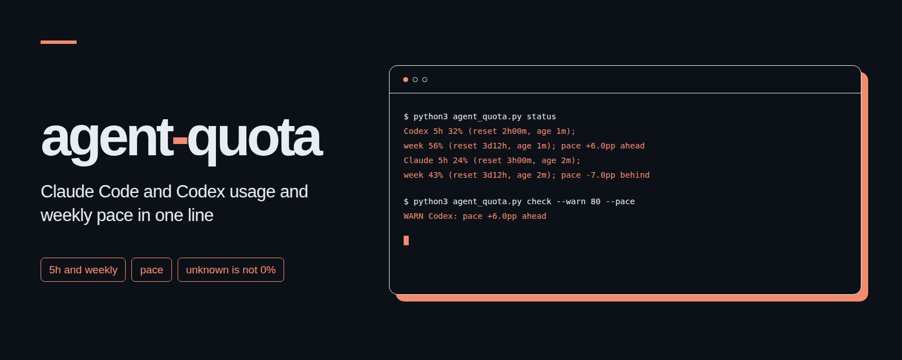

# agent-quota
<p align="center"></p>

See Claude Code and Codex CLI subscription usage and weekly spending pace in one terminal line.

[한국어](README.ko.md)

## Why

A percentage alone does not tell you whether your quota will last until reset. This small local tool shows the 5-hour and weekly percentages, time to reset, record age, and how far usage is ahead of or behind an even weekly pace. It uses only Python's standard library and makes no network requests.

## Install in three steps

1. Download and unpack this repository, then open its folder. Use Python 3.10 or newer. Sign in to Codex CLI and Claude Code with your subscription as usual.
2. Copy the single script to a stable location:

   ```sh
   mkdir -p "$HOME/.local/share/agent-quota"
   cp agent_quota.py "$HOME/.local/share/agent-quota/agent_quota.py"
   ```

3. Merge this entry into `~/.claude/settings.json`, keeping your other settings:

   ```json
   {
     "statusLine": {
       "type": "command",
       "command": "python3 \"$HOME/.local/share/agent-quota/agent_quota.py\" statusline"
     }
   }
   ```

   Claude Code sends JSON on standard input. After a response containing quota data, the hook prints a Claude usage line and writes `~/.cache/agent-quota/claude.json`. Run `python3 ~/.local/share/agent-quota/agent_quota.py status` to see both engines. Codex data comes from existing files in `~/.codex/sessions`; this tool does not start a session to refresh it.

The [official Claude Code status line documentation](https://code.claude.com/docs/en/statusline#available-data), checked on **2026-11-02**, documents `rate_limits.five_hour.used_percentage`, `rate_limits.seven_day.used_percentage`, and each window's `resets_at` in Unix seconds. It states that these windows may be absent independently and appear for eligible subscriptions after the first API response. `context_window.used_percentage` measures context space, not subscription quota, and is never used here. If your client sends no quota fields, the hook only reads an existing cache; use the manual cache format below if necessary.

## Commands

Run from the repository folder, or substitute the installed script's path.

| Command | Result |
| --- | --- |
| `python3 agent_quota.py status` | One line with both engines, both windows, age, and weekly pace |
| `python3 agent_quota.py status --json` | Versioned JSON snapshot; unknown measurements are `null` |
| `python3 agent_quota.py check --warn 80 --pace` | Warn at or above 80% in either window, or ahead of weekly pace |
| `python3 agent_quota.py check --engine codex` | Check only Codex, useful when only one engine is configured |
| `python3 agent_quota.py statusline` | Read Claude Code JSON from stdin, cache quota fields, print a Claude line |
| `python3 agent_quota.py status --codex-dir ./sessions --claude-cache ./data/claude.local.json` | Read custom local sources |
| `python3 agent_quota.py check --stale-hours 3` | Use a 3-hour freshness limit instead of 6 hours |

Options follow the subcommand. `--claude-cache PATH` and `--stale-hours HOURS` work with all commands. `--engine all|codex|claude` and `--codex-dir PATH` work with `status` and `check`. Use the same cache path in both the hook and the reader when overriding it.

`check` always prints one line. Exit **0** means all selected windows are current and below the enabled warning limits. Exit **1** means attention is needed: a threshold, a pace warning, a stale record, an unknown value, or a passed reset. Stale and unknown values never produce a fresh threshold or pace claim. Exit **2** means invalid arguments, invalid hook input, or a cache write failure. `status` reports missing data without failing; inspect its fields when consuming JSON. Connect `check` to cron or an existing notification tool; the program itself sends no notifications.

## Example output

Invented values, not a live account snapshot:

```text
Codex 5h 32% (reset 2h00m, age 1m); week 56% (reset 3d12h, age 1m); pace +6.0pp ahead | Claude 5h 24% (reset 3h00m, age 2m); week 43% (reset 3d12h, age 2m); pace -7.0pp behind
WARN Codex: pace +6.0pp ahead
WARN Claude week: stale record (age 7h00m)
```

`unknown` is never substituted with `0%`. After a reset passes, usage becomes unknown until another measurement arrives. Stale percentages remain visible as old measurements with `stale record`; their pace becomes unknown.

## How pace works

Treat a week as exactly seven days ending at the reported weekly reset:

```text
days_left = (weekly_reset - now) / 86400
expected_used_percentage = 100 * (1 - days_left / 7)
pace_delta_pp = used_percentage - expected_used_percentage
daily_budget_percentage = (100 - used_percentage) / days_left
```

A positive delta means you have spent more than the even weekly share available by now. A negative delta means you have spent less. The remaining daily allowance divides the remaining weekly quota by the days left, including fractional days. Ahead of pace means that allowance is below the even baseline of `100 / 7` percentage points per day. In the invented Codex example, half the week has elapsed, 56% is used, and the remaining daily allowance is about 12.57 percentage points. This is a planning estimate from a snapshot, not a measurement of today's consumption or a forecast of future work. Pace uses the current clock and is not calculated from stale, expired, or incomplete data.

## Manual Claude cache

If your Claude Code version or account does not supply quota fields, write a UTF-8 JSON file using this format. The timestamps and percentages below are invented. Replace them with your own measurement time, actual usage, and reset times. Timestamp values can be Unix seconds or timezone-aware RFC 3339 strings. Do not use file modification time as measurement time.

```json
{
  "observed_at": "2030-06-18T11:58:00Z",
  "rate_limits": {
    "five_hour": {
      "used_percentage": 24,
      "resets_at": "2030-06-18T15:00:00Z"
    },
    "seven_day": {
      "used_percentage": 43,
      "resets_at": "2030-06-22T00:00:00Z"
    }
  }
}
```

Point both commands at that file with `--claude-cache PATH`. A window may have its own `observed_at`, overriding the top-level time. The hook records receive time per window, keeps a missing window's original time, and never refreshes the cache when neither quota window is supplied. Explicit `null` or malformed window data invalidates that window. Only quota percentages and timestamps are saved, using an atomic file replacement. On systems with POSIX permissions, hook-written files are private to the current user.

## JSON and agent-wallboard

The output has `schema_version`, `generated_at`, and `engines.codex` / `engines.claude`. Each engine has `windows.five_hour`, `windows.seven_day`, and `pace`. Windows contain `used_percentage`, `resets_at`, `remaining_seconds`, `observed_at`, `age_seconds`, and a `status` of `current`, `stale`, `expired`, or `unknown`. Pace includes `delta_pp`, `daily_budget_percentage`, and its `status`. All times are UTC strings or durations in seconds; a missing measurement is `null`.

To put this in [agent-wallboard](https://github.com/kks0488/agent-wallboard), keep your existing valid board snapshot and add one `notices` row using its [documented snapshot format](https://github.com/kks0488/agent-wallboard/blob/main/docs/schema.md). This example runs from the quota folder, reads `data/board.local.json` copied from your board producer, replaces only the quota notice, and updates the board time. Point the wallboard server's `--data` argument at that board file; a quota snapshot alone is not a complete wallboard snapshot.

```sh
mkdir -p data
python3 agent_quota.py status --json > data/quota.local.json
python3 - <<'PY'
from datetime import datetime
import json
from pathlib import Path
import time
from agent_quota import status_line

board_path = Path("data/board.local.json")
board = json.loads(board_path.read_text(encoding="utf-8"))
quota = json.loads(Path("data/quota.local.json").read_text(encoding="utf-8"))
board["notices"] = [row for row in board["notices"] if row["id"] != "agent-quota"]
board["notices"].append({"id": "agent-quota", "title": "Subscription quota",
                         "extra": status_line(quota)})
board.update(now=time.time(), at=datetime.now().strftime("%m/%d %H:%M"))
temporary = board_path.with_suffix(".tmp")
temporary.write_text(json.dumps(board, ensure_ascii=False), encoding="utf-8")
temporary.replace(board_path)
PY
```

## Limits

- Codex session JSONL is an unofficial storage format and may change. The reader compares the last quota event in each session by event time, assuming records within a session are appended in time order. It reads backwards in chunks and does not export conversation text.
- Supported Codex events are `event_msg` / `token_count` with `payload.rate_limits.primary` or `secondary`, containing `used_percent`, `window_minutes`, and `resets_at`. Durations must be 300 or 10080 minutes. Slot names do not determine duration. A newer null or unsupported quota snapshot does not revive an older reading.
- Missing, malformed, ambiguous, or expired readings stay unknown. Percentages must be finite numbers from 0 to 100. The tool does not infer quota from token counts, cost estimates, or context usage.
- It does not poll either provider. A hook timestamp means JSON was received then; the upstream measurement can be older. A quiet CLI may leave a stale cache or log. Default freshness is six hours per window.
- There is one local source per engine. Keep accounts separate using different session directories and cache files. Switching accounts in a shared directory can leave another account's historical measurements there. Model-specific limits and extra usage are not combined into a total subscription allowance.

## Tests

```sh
python3 -m unittest -v
```

Tests use invented session logs, stdin JSON, and cache files in temporary folders. They do not read your real sessions or change Claude Code settings.

## License

[MIT](LICENSE). Copyright (c) 2026 kks0488.
